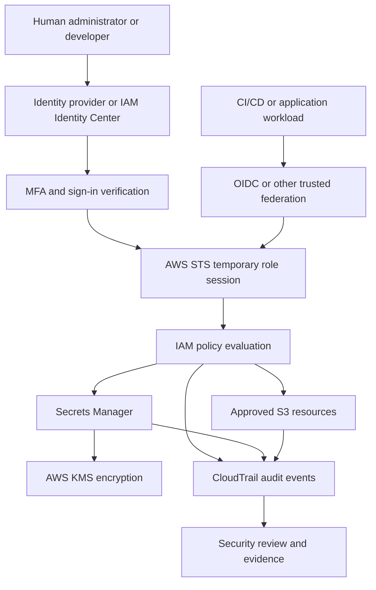
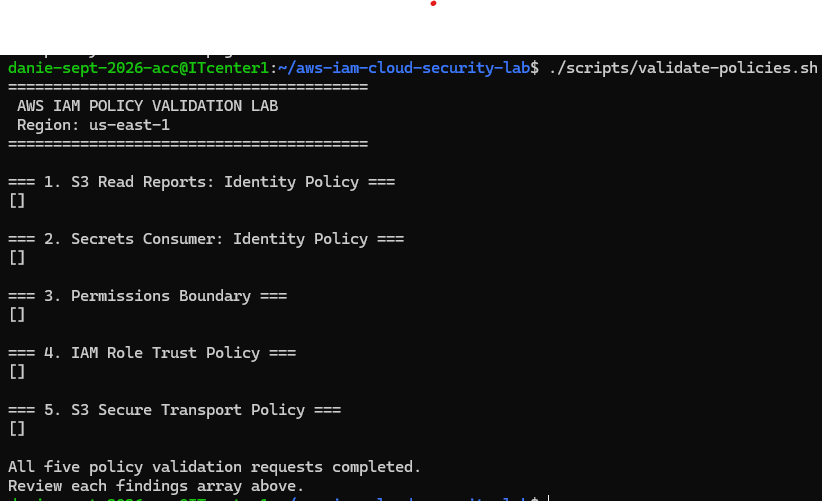
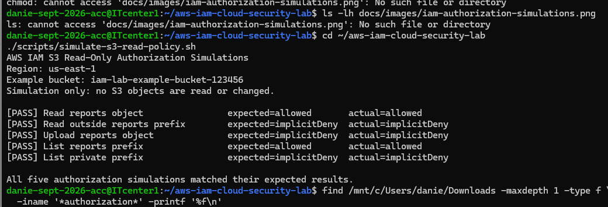

# AWS IAM and Cloud Security Least-Privilege Lab

## Project Purpose

This lab demonstrates how to design, document, test, and audit
access controls in AWS. It focuses on least privilege, authentication,
authorization, secrets management, encryption, and accountability.

This repository begins with local policy examples and documentation.
A policy file in this repository is not an AWS permission until it
has been reviewed and deliberately applied.

## Security Principles

- Least privilege: allow only the actions required for a task.
- Strong authentication: use MFA and trusted federation where appropriate.
- Temporary credentials: prefer IAM roles and short-lived sessions.
- Separation of duties: distinguish administration, workload access,
  secret consumption, and audit responsibilities.
- Defense in depth: use IAM policies, resource policies, trust policies,
  encryption, and other applicable controls together.
- Accountability: preserve and review audit events.
- Secure secrets: never commit actual passwords, tokens, keys, or secret values.
- Verification: test both expected allowed actions and expected denials.

## Architecture Diagram

This diagram describes the target security design. It does not indicate
that these identities, policies, or AWS resources have been deployed.

## Authentication Mechanisms

| Mechanism | Purpose | Lab focus |
|---|---|---|
| Console password | Interactive sign-in where IAM user passwords are used | Understand risks and MFA requirements |
| MFA | Adds a second verification factor | TOTP authenticator or supported security key |
| IAM Identity Center | Centralized workforce sign-in and permission assignments | Prefer workforce federation over creating unnecessary IAM users |
| SAML 2.0 | Enterprise identity federation | Understand signed assertions and role mapping |
| OpenID Connect (OIDC) | Federated authentication for compatible identity providers | Model CI/CD workload access |
| AWS STS | Issues temporary security credentials | Understand role sessions and expiration |
| AWS access keys | Long-lived programmatic credentials | Learn risks, rotation, and avoidance |
| AWS Signature Version 4 | Signs AWS API requests | Understand authenticated API request signing |

Authentication establishes or verifies an identity. It does not automatically grant access to every AWS service.

## Authorization Mechanisms

| Mechanism | Purpose |
|---|---|
| Identity-based policy | Grants actions to users, groups, or roles |
| Resource-based policy | Controls access to a supported resource, such as an S3 bucket |
| Role trust policy | Defines which principals may assume a role |
| Permissions boundary | Sets a maximum permissions boundary for an IAM identity; it does not grant permissions itself |
| Session policy | Can restrict permissions for a role session |
| Attribute-based access control (ABAC) | Uses tags and request attributes to control access |
| Explicit deny | Blocks matching actions even when another applicable policy allows them |
| Service control policy (SCP) | Sets permission guardrails for accounts in AWS Organizations |
| Resource control policy (RCP) | Sets supported resource-level permission guardrails in AWS Organizations |

Effective permissions depend on the applicable policies, their conditions, the principal and resource, and AWS policy evaluation rules. No one policy should be assumed to override all other controls.

## Technical Roles and Separation of Duties

| Example role | Intended responsibility |
|---|---|
| IAM administrator | Manage identities, policies, and trust relationships |
| Cloud administrator | Operate approved cloud resources |
| Application developer | Access designated development resources |
| Workload execution role | Give an application or automation workload limited permissions |
| Secrets consumer | Retrieve only approved application secrets |
| Secret rotation role | Perform the actions required for approved secret rotation |
| Security auditor | Inspect evidence and audit events without unnecessary modification rights |
| Organization administrator | Manage organization-level guardrails where AWS Organizations is available |

These are role designs for the lab, not identities that have already been created.

## Secrets Management and Encryption

The lab will use a dummy secret value only if a live Secrets Manager exercise is later approved.

Topics include:
- Secrets Manager permissions scoped to specific secret ARNs
- AWS-managed versus customer-managed KMS keys
- Encryption at rest and TLS in transit
- Secret retrieval and rotation responsibilities
- Avoiding secret values in source code, terminal logs, screenshots, and Git history
- Monitoring access to Secrets Manager and KMS

Secrets Manager encrypts secret values using AWS KMS. A customer-managed KMS key can require additional IAM permissions and key-policy configuration.

## Accountability and Auditing

The accountability module will examine:
- CloudTrail management events
- Console sign-in and role-assumption activity where recorded
- IAM policy or role changes
- Secret-access events
- Access denied outcomes
- Investigation notes and evidence capture

CloudTrail Event history provides a regional view of the past 90 days of management events. It is not a replacement for a separately configured trail or event data store when longer-term retention or additional event types are required.

## Validation and Testing

The local lab will:
1. Validate JSON syntax.
2. Review policy actions and resource scopes.
3. Verify that example policy ARNs are placeholders.
4. Test allowed and denied access in an approved environment if deployed.
5. Document the observed results without claiming unperformed tests.

## Repository Structure

- `policies/identity-based/` — identity permission policy examples
- `policies/resource-based/` — resource policy templates
- `policies/trust/` — role trust policy examples
- `policies/permissions-boundary/` — permissions boundary example
- `policies/session/` — session policy example
- `examples/` — learning notes and test cases
- `terraform/` — future, reviewed Terraform examples
- `docs/images/` — genuine screenshots and evidence

## Security and Cost Guardrails

- Never commit real credentials, secret values, tokens, private keys,
  Terraform state, or live session credentials.
- Treat all example account IDs, ARNs, role names, and bucket names as
  placeholders until deliberately replaced and reviewed.
- Do not grant wildcard administrative permissions for convenience.
- Do not create IAM users or access keys unless a specific exercise requires them.
- Do not deploy policies or create AWS resources without reviewing their impact.
- Assess current AWS pricing before using paid services or creating KMS keys.
- Remove test resources only after verifying what the cleanup operation will affect.

## Future Improvements

- Add policy validation and simulation exercises.
- Add IAM Identity Center and MFA learning exercises.
- Model an OIDC trust relationship for CI/CD.
- Add a Secrets Manager and KMS exercise using dummy data.
- Add CloudTrail investigation examples.
- Add diagrams and real validation screenshots as each module is completed.

## Policy Testing Matrix

See [the policy test matrix](docs/policy-test-matrix.md) for expected Allow and Deny cases, testing notes, and evidence requirements.

## Policy Validation Evidence

See [the validation report](docs/policy-validation-results.md) for the five policy documents checked and the limitations of the results.

The screenshot records the observed validation output. It does not establish that the example policies were deployed or that live authorization tests have passed.

## Authorization Simulation Evidence

The screenshot below records the five observed authorization simulations for the S3 reports policy.

The results are simulated decisions against example resource ARNs. They do not establish that an S3 bucket exists or that live requests have been tested.

## IAM Roles and AWS STS

See the [IAM roles and STS guide](docs/iam-roles-and-sts.md) for the caller permissions, role trust, temporary credentials workflow, and security considerations.
