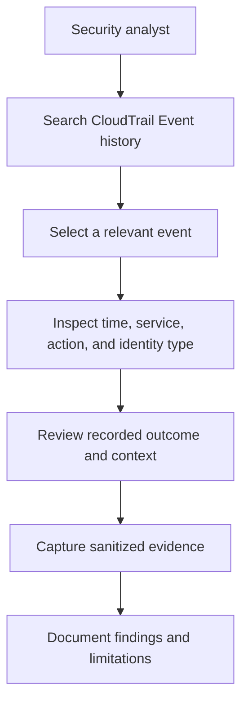
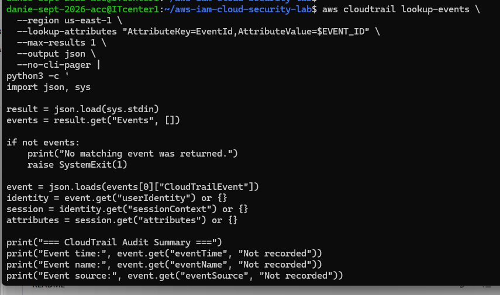

# AWS CloudTrail Accountability and Audit Investigation

## Purpose

This guide documents a read-only investigation using AWS CloudTrail Event history. It focuses on finding recorded activity, reviewing event details, and preserving evidence responsibly.

## Investigation Workflow

## Evidence Fields

Relevant CloudTrail fields may include:

- `eventTime`: recorded event time
- `eventSource`: AWS service that received the request
- `eventName`: requested action
- `awsRegion`: Region associated with the event
- `userIdentity`: information about the requesting identity
- `errorCode` and `errorMessage`: error details, when present
- `sourceIPAddress`: recorded source address, when available

Review identifying fields carefully. Do not publish credentials, tokens, account identifiers, source IP addresses, or sensitive request data.

## Event History Scope

CloudTrail Event history provides a regional view of management events for the previous 90 days. It does not automatically include every data event, such as individual S3 object reads. Additional data-event logging or longer retention may require separate configuration.

An event record is evidence of activity recorded by CloudTrail. It does not, by itself, establish the business purpose or legitimacy of that activity.

## Investigation Evidence

This screenshot records the investigation evidence captured during the lab. Interpret the displayed fields using the actual record shown. Do not infer unrecorded identity, MFA, or authorization details.

## Investigation Checklist

1. Select the AWS Region and time range.
2. Search by service, event name, or event identifier.
3. Inspect the timestamp, action, and identity details.
4. Review recorded error information, if present.
5. Separate observed facts from assumptions.
6. Preserve sanitized evidence and document limitations.
7. Avoid publishing sensitive event data.

## Security and Cost Notes

- Do not publish raw events containing sensitive information.
- Do not change logging configuration during this read-only exercise.
- Assess cost and retention requirements before enabling additional trails, data-event logging, or long-term event storage.

## Status and Limitations

This guide documents the investigation workflow and the captured screenshot. It does not claim that a new CloudTrail trail was created, that all AWS activity was captured, or that a security incident occurred.
