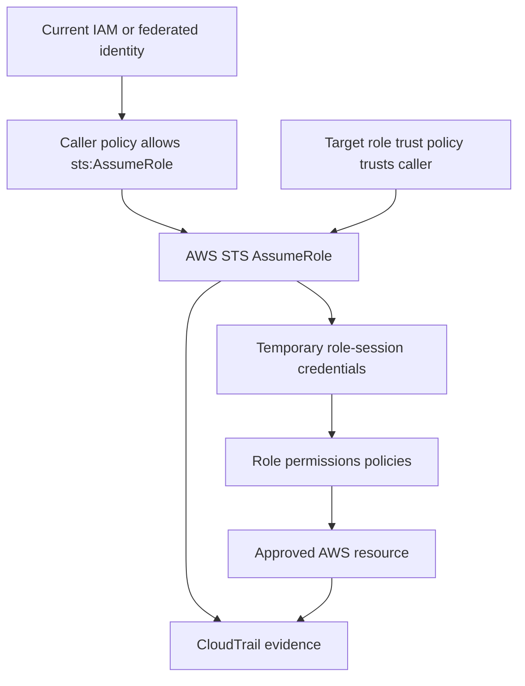

# IAM Roles, Trust Policies, and AWS STS

## Purpose

This module explains how an AWS principal requests access to an IAM role and how AWS Security Token Service (STS) provides temporary credentials. The files in this repository are examples only; this guide does not indicate that any role has been created or assumed.

## The Three-Part Model

1. **Caller permissions:** the caller needs permission to perform `sts:AssumeRole` on the target role.
2. **Role trust policy:** the target role must trust the requesting principal.
3. **Role permissions:** policies attached to the role determine the actions allowed during the role session, subject to all applicable AWS authorization controls.

## Workflow Diagram

## Important Distinctions

- A caller policy alone does not make an untrusted role assumable.
- A trust policy alone does not grant access to every AWS resource.
- STS credentials expire. Never copy secret access keys or session tokens into source code, screenshots, or GitHub.
- Role session duration is subject to AWS STS limits and the target role configuration.
- A policy simulator result is not proof that a live `AssumeRole` request will succeed.

## Validation Plan

1. Validate the caller policy with IAM Access Analyzer.
2. Review the target role trust policy and intended principal.
3. Confirm the role permissions are narrowly scoped.
4. Simulate supported authorization decisions where appropriate.
5. Perform a live role-assumption exercise only after reviewing the account, trust relationship, and permission impact.

## Security Guardrails

- Keep example account IDs and role names as placeholders in public code.
- Do not create access keys merely to complete this module.
- Never print temporary credential values.
- Do not attach the example policy to a live identity without review.
