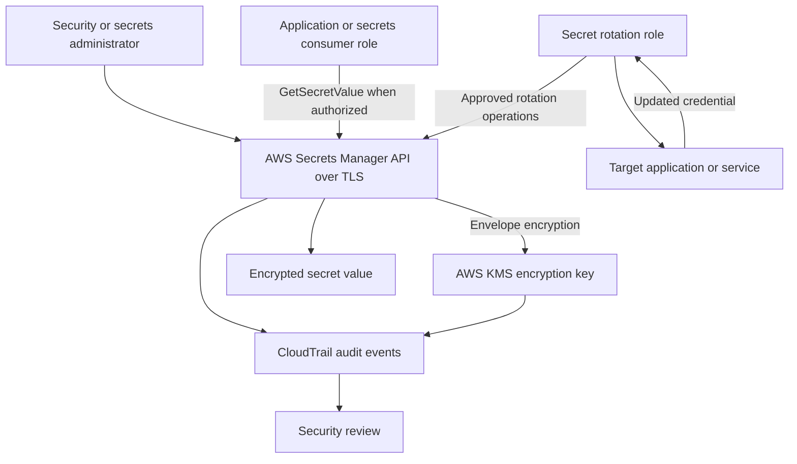

# AWS Secrets Manager and KMS Encryption Lab

## Project Purpose

This module demonstrates secure secret storage, least-privilege secret
access, KMS encryption, separation of duties, rotation concepts, and
audit evidence.

This guide and its example policies do not create or modify AWS
resources. No real secret values belong in this repository.

## Security Architecture

The diagram describes the intended design, not a deployed architecture.
Secret rotation must update both the stored secret and the actual
target system or service. Merely changing a value in Secrets Manager
does not automatically change a database password or external credential.

## Separation of Duties

| Role | Intended permissions |
|---|---|
| Secrets consumer | Retrieve only an approved secret |
| Metadata reviewer | Describe a secret and review its version metadata |
| Secrets administrator | Create, configure, and manage approved secrets |
| Rotation role | Perform the specific actions required for an approved rotation |
| KMS key administrator | Manage key configuration and key policy |
| Security auditor | Review relevant audit events without unnecessary write access |

Do not give every role permission to create, read, rotate, delete, and
administer all secrets. Separate duties according to the task performed.

## Encryption With AWS KMS

Secrets Manager encrypts secret values using envelope encryption:
AWS KMS protects a data key, and that data key encrypts the secret value.

Two common choices are:

- AWS-managed key: `aws/secretsmanager`. AWS manages the key policy.
- Customer-managed KMS key: provides more control over key policy,
  permissions, and key lifecycle, but requires deliberate configuration.

When a secret uses a customer-managed key, the caller and key policy
must provide the required KMS permissions for the operation. A policy
that allows `secretsmanager:GetSecretValue` alone may not be sufficient.

The secret name, description, rotation configuration, associated KMS
key ARN, and tags are metadata; do not assume they are encrypted as
part of the secret value.

## Least-Privilege Access

The consumer should receive only the permission needed to retrieve
an approved secret. The resource ARN should be narrowed to that
secret rather than using a wildcard for every secret.

For customer-managed KMS keys, a decrypt permission can be restricted
to a specific key, requests originating through Secrets Manager, and
the expected secret encryption context. The actual KMS key policy
must also permit the intended use.

## Rotation

Rotation changes credentials periodically. For secrets associated
with databases or services, a rotation process must coordinate the
secret value with the credential stored by the target system.

Some rotation flows use a Lambda function. The function needs its own
execution role, narrowly scoped access to the secret, and the minimum
permissions needed to update and verify the target system.

This lab does not deploy a rotation function. We will first document
the required permissions and understand the dependencies.

## Accountability

CloudTrail can record relevant Secrets Manager and KMS API activity.
Review access events, secret modifications, key operations, and
rotation-related activity where those events are available.

Do not put secret values, credentials, or session tokens in command
output, screenshots, or logs.

## Validation Plan

1. Validate example policy JSON.
2. Run IAM Access Analyzer policy validation.
3. Review the consumer, metadata-reviewer, and customer-managed-key examples.
4. Simulate representative allowed and denied authorization decisions
   where supported.
5. If a live exercise is later approved, use dummy data and review
   costs before creating AWS resources.
6. Capture actual validation evidence and record limitations.

## Security and Cost Guardrails

- Never commit real secrets, passwords, tokens, access keys, or private keys.
- Never use a real application password as a portfolio example.
- Keep account IDs, secret ARNs, and KMS key ARNs as placeholders.
- Do not create a customer-managed KMS key or enable automatic rotation
  just to complete the documentation module.
- Check current AWS pricing before creating Secrets Manager secrets,
  customer-managed KMS keys, or rotation-related Lambda resources.
- Review all permissions before attaching a policy to an identity.
